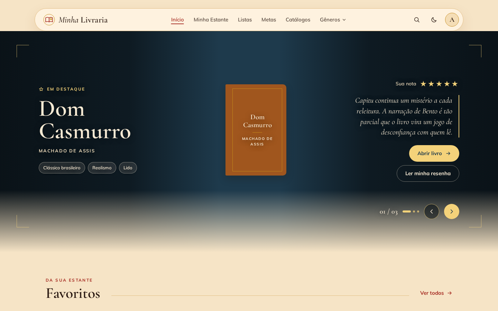
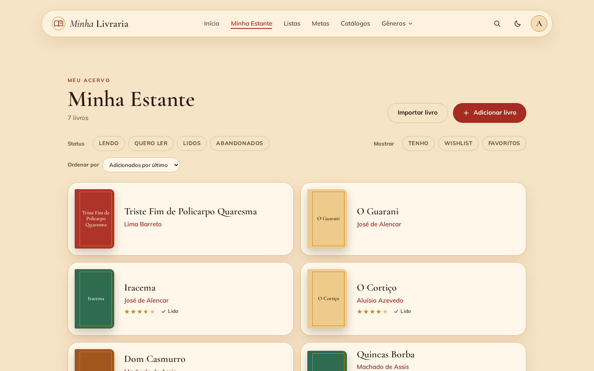
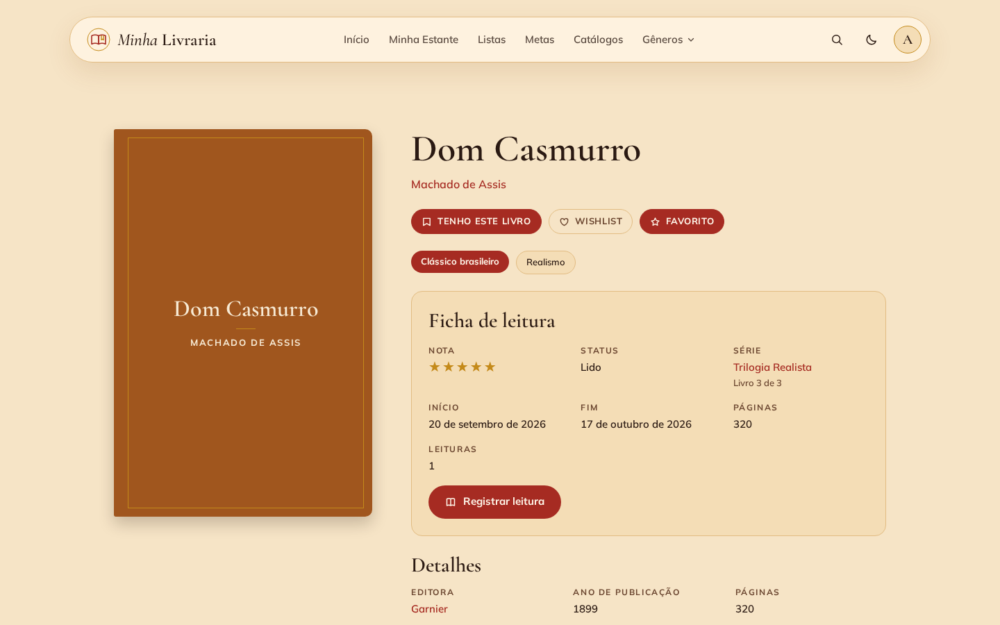
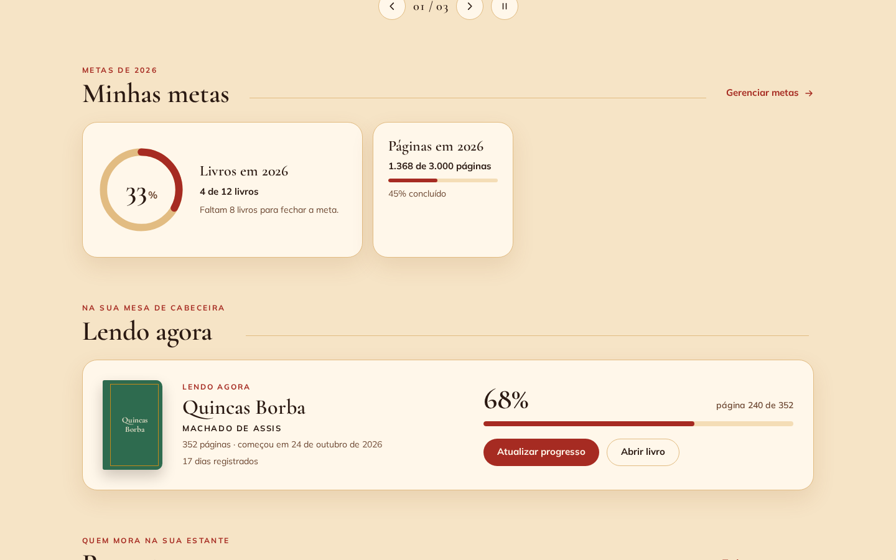
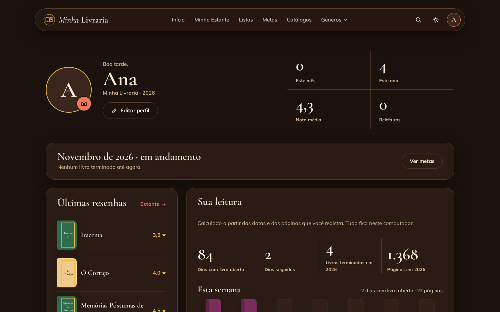
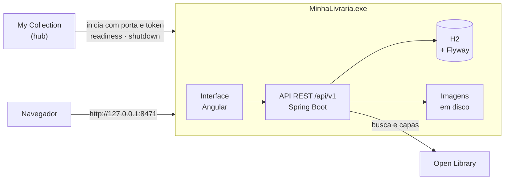

# Minha Livraria

[](https://github.com/BrunaSanguini/MyLibrary/actions/workflows/ci.yml)
[](https://sonarcloud.io/summary/new_code?id=BrunaSanguini_MyLibrary)
[](https://github.com/BrunaSanguini/MyLibrary/releases/latest)
[](LICENSE)

Biblioteca pessoal para desktop: o acervo, as leituras dia a dia, as resenhas, as listas e as metas, num app que roda inteiro no seu computador. Os dados dos livros podem vir da [Open Library](https://openlibrary.org/developers/api).



## O que dá para fazer

- **Acervo:** cadastrar livros à mão ou importá-los da Open Library pelo título, autor ou ISBN, com capa, gêneros, subgêneros, série e editora.
- **Estante:** buscar sem se preocupar com acentos, filtrar por status, posse, gênero, autor ou série e ordenar por título, nota ou data.
- **Leitura:** registrar o início, as páginas de cada dia, o término ou o abandono, e também releituras. Cada livro mostra o próprio progresso.
- **Resenhas:** nota de 1 a 5, com meio ponto, e o texto da resenha.
- **Listas:** juntar livros do seu jeito e ordená-los só pelo teclado, se quiser.
- **Metas:** livros, páginas ou releituras, por ano ou por mês, com o progresso calculado das leituras.
- **Perfil:** números do mês e do ano, sequência de dias lendo, mapa de calor dos últimos seis meses e o ritmo de leitura.
- **Tema claro e escuro**, acessível pelo teclado e por leitores de tela (WCAG 2.1 AA conferido pelo axe a cada mudança).

| Estante | Página do livro |
|---|---|
|  |  |

| Metas e leitura em andamento | Perfil (tema escuro) |
|---|---|
|  |  |

## Instalação (Windows)

Requer Windows 10 ou 11 (64 bits). O Java já vem dentro do pacote.

1. Baixe `minha-livraria-X.Y.Z-windows-x64.zip` na [última versão](https://github.com/BrunaSanguini/MyLibrary/releases/latest).
2. *(Opcional)* Confira o arquivo com o `.sha256` publicado ao lado. No PowerShell, os dois valores devem ser iguais:

   ```powershell
   (Get-FileHash .\minha-livraria-X.Y.Z-windows-x64.zip -Algorithm SHA256).Hash
   Get-Content .\minha-livraria-X.Y.Z-windows-x64.zip.sha256
   ```

3. Extraia o zip numa pasta sua, como `C:\Apps`. Ela vai conter `MinhaLivraria\MinhaLivraria.exe`.

O executável não é assinado digitalmente. Na primeira vez, o Windows pode mostrar o aviso do SmartScreen: clique em **Mais informações** e depois em **Executar assim mesmo**.

## Como usar

### Pelo My Collection

O jeito previsto é abrir pelo [My Collection](https://github.com/BrunaSanguini/MyCollection), o hub que inicia os apps locais. Ele inicia o app, espera ficar pronto, abre o navegador e, ao fechar, encerra o app de forma segura.

### Sem o My Collection

No PowerShell, inicie o app com um token de encerramento e abra o endereço no navegador:

```powershell
$env:MINHA_LIVRARIA_SHUTDOWN_TOKEN = 'um-segredo-qualquer'
C:\Apps\MinhaLivraria\MinhaLivraria.exe
```

Depois de alguns segundos, abra <http://127.0.0.1:8471/>. Para fechar, rode no PowerShell:

```powershell
Invoke-RestMethod -Method Post -Uri http://127.0.0.1:8471/actuator/shutdown `
  -ContentType 'application/json' -Headers @{ 'X-MyCollection-Token' = 'um-segredo-qualquer' }
```

Assim o app fecha o banco corretamente. Encerrar o processo à força pode perder o que foi salvo por último.

Se a porta 8471 estiver ocupada, use outra: `MinhaLivraria.exe --server.port=8480`.

### Seus dados

Tudo fica em `%USERPROFILE%\.minha-livraria`:

| Pasta | Conteúdo |
|---|---|
| `data\` | o banco (H2) |
| `images\` | capas, banners e o avatar; o que é trocado fica 30 dias em `images\.trash\` |
| `backups\` | cópias automáticas do banco, feitas antes de cada atualização que muda a estrutura dele |
| `logs\` | registros do app |

Para fazer backup, copie a pasta inteira com o app fechado. Atualizar o app é só extrair a versão nova por cima: os dados não ficam na pasta do programa.

**Open Library:** a busca funciona sem configuração, mas a Open Library pede que cada app informe um contato. Crie `%USERPROFILE%\.minha-livraria\config.yml` com:

```yaml
app:
  open-library:
    contact: seu-email@exemplo.com
```

Sem internet, o cadastro manual continua funcionando.

## Arquitetura

Um único executável: o Spring Boot serve a API REST e a interface Angular já compilada, ouvindo só em `127.0.0.1`.



| Camada | Tecnologias |
|---|---|
| Back-end | Java 25 · Spring Boot 4.1 · Spring Modulith · Spring Data JPA · H2 · Flyway · springdoc-openapi |
| Front-end | Angular 22 (standalone, zoneless, Signals e Signal Forms) · TypeScript 6 · CSS com design tokens |
| Testes | JUnit 5 · Spring Boot Test · WireMock · Vitest · Testing Library · Playwright · axe |
| Entrega | Maven · jlink · jpackage · GitHub Actions · release-please · Renovate · SonarQube Cloud |

- **Monólito modular:** os módulos `books`, `reading`, `lists`, `goals`, `profile`, `images`, `openlibrary` e `shelf` só se falam pelas APIs públicas de cada um, e o Spring Modulith verifica essas fronteiras nos testes.
- **Contrato da API** em OpenAPI, versionado em [`docs/openapi.json`](docs/openapi.json). Os tipos do front são gerados dele, e um teste falha se o contrato mudar sem atualização.
- **Erros** no padrão Problem Details (RFC 9457), com mensagens em português e um [catálogo de códigos](docs/erros.md).

As decisões e as alternativas descartadas estão nos [ADRs](docs/adr/README.md).

## Desenvolvimento

Pré-requisitos: JDK 25 (Eclipse Temurin) e Node.js 26 LTS (o Node é só para desenvolver o front; o build Maven instala o próprio).

```bash
npm ci                  # na raiz: hooks de commit (Husky, lint-staged, commitlint)
cd frontend && npm ci   # dependências da interface
```

| Para | Comando |
|---|---|
| Rodar a API (perfil `dev`, dados em `backend/.local-data/`) | `cd backend && ./mvnw spring-boot:run -Dspring-boot.run.profiles=dev` |
| Rodar a interface (`http://localhost:4200`, com proxy para a API) | `cd frontend && npm start` |
| Gerar o jar completo | `cd backend && ./mvnw package -DskipTests` → `java -jar target/minha-livraria.jar` |
| Testes do back-end | `cd backend && ./mvnw verify` |
| Testes do front-end | `cd frontend && npm test` |
| Testes E2E (sobem o jar) | `cd frontend && npm run e2e` |
| Pacote do Windows | `./scripts/package-windows.ps1 -Version X.Y.Z` (PowerShell, depois do jar) |

No Windows, use `mvnw.cmd` no lugar de `./mvnw`. No perfil `dev`, a documentação interativa da API fica em `http://127.0.0.1:8471/swagger-ui.html`, e o app carrega os dados de exemplo (clássicos brasileiros em domínio público).

## Documentação

- [Roadmap](docs/roadmap.md)
- [Decisões de arquitetura (ADRs)](docs/adr/README.md)
- [Modelo de dados](docs/modelo-de-dados.md)
- [Arquitetura do back-end](docs/arquitetura-back-end.md)
- [Contrato da API](docs/contrato-da-api.md) e [catálogo de erros](docs/erros.md)
- [Arquitetura do front-end](docs/arquitetura-front-end.md)
- [Testes e qualidade](docs/testes-e-qualidade.md)
- [CI/CD](docs/ci-cd.md)
- [Convenções do projeto](CONTRIBUTING.md)

## Licença

Distribuído sob a licença [MIT](LICENSE).
