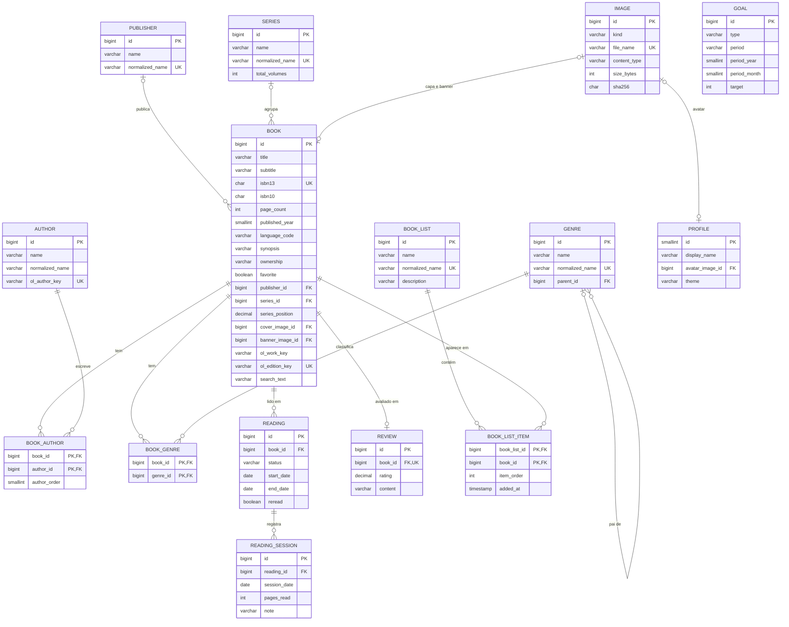

# Modelo de dados

Modelo de domínio e banco da Minha Livraria. As decisões e as alternativas descartadas estão no [ADR-0003](adr/0003-modelo-de-dominio-e-banco.md).

## Módulos

| Módulo | Tabelas | Responsabilidade |
|---|---|---|
| `books` | `book`, `author`, `book_author`, `publisher`, `series`, `genre`, `book_genre` | Catálogo: livros, autores, editoras, séries, gêneros e subgêneros |
| `reading` | `reading`, `reading_session`, `review` | Leituras, progresso, nota e resenha |
| `lists` | `book_list`, `book_list_item` | Listas de livros |
| `goals` | `goal` | Metas de leitura |
| `profile` | `profile` | Nome, avatar e tema |
| `images` | `image` | Registro das imagens salvas em disco |

Dois módulos não têm tabelas:
- O `openlibrary` é apenas integração.
- O `shelf` só lê as tabelas dos outros módulos para montar os cards de livro ([ADR-0005](adr/0005-contrato-da-api.md)).

**Fronteiras:** dentro de um módulo as entidades se relacionam por JPA. Entre módulos, a referência é só pelo ID (ex.: `Long bookId` em `Reading`). O banco mantém as chaves estrangeiras para garantir a integridade.

## Diagrama

As colunas de auditoria (`created_at`, `updated_at`) foram omitidas do diagrama.

## Tabelas

### `books`

**`book`**: uma edição específica de um livro.

| Coluna | Tipo | Regra |
|---|---|---|
| `title` | `VARCHAR(500)` | obrigatório |
| `subtitle` | `VARCHAR(500)` | opcional |
| `isbn13` | `CHAR(13)` | 13 dígitos; único quando informado |
| `isbn10` | `CHAR(10)` | 9 dígitos + dígito verificador de `0` a `9` ou `X` (maiúsculo) |
| `page_count` | `INT` | maior que zero; obrigatório para registrar sessões |
| `published_year` | `SMALLINT` | opcional |
| `language_code` | `VARCHAR(3)` | código ISO 639-2, como na Open Library (`por`, `eng`) |
| `synopsis` | `VARCHAR(10000)` | opcional |
| `ownership` | `VARCHAR(10)` | `OWNED` (Tenho), `WISHLIST` ou `NONE`; padrão `NONE` |
| `favorite` | `BOOLEAN` | padrão `false`; alimenta o carrossel de favoritos |
| `publisher_id` | `BIGINT` | FK `publisher`, `ON DELETE SET NULL` |
| `series_id` / `series_position` | `BIGINT` / `DECIMAL(4,1)` | FK `series`; preenchidos juntos ou nulos juntos (`CHECK`); posição maior que zero (aceita 2,5) |
| `cover_image_id` / `banner_image_id` | `BIGINT` | FK `image`, `ON DELETE SET NULL` |
| `ol_work_key` / `ol_edition_key` | `VARCHAR(32)` | chaves da Open Library; `ol_edition_key` único |
| `search_text` | `VARCHAR(1001)` | título e subtítulo normalizados (minúsculas, sem acento), recalculados ao salvar; cabe o tamanho máximo dos dois mais o espaço |

Os dígitos verificadores do ISBN são validados no serviço.

**`author`**: `name` (`VARCHAR(200)`), `normalized_name` (indexado, também usado na busca) e `ol_author_key` (único, opcional). Não é possível excluir um autor que ainda tem livros.

**`book_author`**: chave (`book_id`, `author_id`) e `author_order`, para manter a ordem dos autores na capa. Remover o livro remove os vínculos.

**`publisher`**: `name` e `normalized_name` (único). Na importação, a editora é reaproveitada pelo nome normalizado. Assim, "Rocco" não vira duas editoras.

**`series`**: `name`, `normalized_name` (único) e `total_volumes` (opcional, para a barra "2 de 3"). Excluir uma série limpa `series_id` e `series_position` dos livros na mesma transação, então nenhum livro fica com posição sem série.

**`genre`**: `name`, `normalized_name` (único) e `parent_id`.
- Gênero tem `parent_id` nulo; subgênero aponta para um gênero.
- Máximo de dois níveis: o pai precisa ser um gênero.
- Não é possível excluir um gênero que tem subgêneros (FK sem cascata). Os subgêneros precisam ser excluídos ou movidos antes.

**`book_genre`**: chave (`book_id`, `genre_id`). Excluir um gênero remove o vínculo dele com os livros.

### `reading`

**`reading`**: uma leitura completa de um livro.

| Coluna | Tipo | Regra |
|---|---|---|
| `book_id` | `BIGINT` | FK `book`, `ON DELETE CASCADE` |
| `status` | `VARCHAR(12)` | `IN_PROGRESS`, `FINISHED` ou `ABANDONED` |
| `start_date` | `DATE` | obrigatório em `IN_PROGRESS`; leituras antigas podem ter só a data de fim |
| `end_date` | `DATE` | obrigatório em `FINISHED` e `ABANDONED`; nulo em `IN_PROGRESS`; nunca antes do início |
| `reread` | `BOOLEAN` | marcado pelo usuário ("Esta é uma releitura") |

No máximo uma leitura `IN_PROGRESS` por livro. A regra fica no serviço e, como o H2 não tem índice parcial, é reforçada no banco por uma coluna gerada com `UNIQUE`.

**`reading_session`**: `reading_id` (FK, `ON DELETE CASCADE`), `session_date`, `pages_read` (maior que zero) e `note` (`VARCHAR(2000)`, opcional).
- A data fica dentro do período da leitura.
- A soma de `pages_read` não passa de `page_count`.
- No formulário, o modo "página atual" é convertido em páginas lidas.

**`review`**: uma por livro (`book_id` único, `ON DELETE CASCADE`).
- `rating` em `DECIMAL(2,1)`, de 1 a 5, com meio ponto (1,0; 1,5; … 5,0).
- `content` em `VARCHAR(20000)`.
- Pelo menos um dos dois precisa estar preenchido.

### `lists`

**`book_list`**: `name` (`VARCHAR(120)`), `normalized_name` (único) e `description` (`VARCHAR(1000)`).

**`book_list_item`**: chave (`book_list_id`, `book_id`), `item_order` e `added_at`. Excluir a lista ou o livro remove o item.

### `goals`

**`goal`**

| Coluna | Tipo | Regra |
|---|---|---|
| `type` | `VARCHAR(10)` | `BOOKS`, `PAGES` ou `REREADS` |
| `period` | `VARCHAR(5)` | `YEAR` ou `MONTH`; `REREADS` só por ano |
| `period_year` | `SMALLINT` | obrigatório |
| `period_month` | `SMALLINT` | 1 a 12 quando `MONTH`; nulo quando `YEAR` |
| `target` | `INT` | maior que zero |

Uma meta por tipo e período, garantida por `UNIQUE` em (`type`, `period_year`, `period_key`). A `period_key` é uma coluna gerada com `COALESCE(period_month, 0)`: sem ela, o `UNIQUE` não barraria metas anuais duplicadas, porque o banco trata dois `NULL` como diferentes.

Um novo tipo (por gênero, por série) entra como novo valor do enum, mais as colunas opcionais que precisar, em uma nova migration.

### `profile`

**`profile`**: linha única (`id = 1`, garantido por `CHECK`), criada na migration inicial.
- `display_name` (`VARCHAR(80)`).
- `avatar_image_id` (FK `image`, `ON DELETE SET NULL`).
- `theme`: `LIGHT`, `DARK` ou `SYSTEM`; padrão `SYSTEM`.

### `images`

**`image`**

| Coluna | Tipo | Regra |
|---|---|---|
| `kind` | `VARCHAR(8)` | `COVER`, `BANNER` ou `AVATAR` |
| `file_name` | `VARCHAR(100)` | `{uuid}.{ext}`, único; caminho `images/{kind}/{file_name}` |
| `content_type` | `VARCHAR(20)` | `image/jpeg`, `image/png` ou `image/webp` |
| `size_bytes` | `INT` | até 5 MB |
| `sha256` | `CHAR(64)` | hash do conteúdo |

- O tipo é validado pelos bytes iniciais do arquivo, não pela extensão.
- O nome do arquivo é um UUID porque ele é gravado antes de o registro existir. Se a transação falhar, o arquivo é apagado.
- Uma imagem nunca muda: trocar a capa cria uma imagem nova. Por isso `GET /api/v1/images/{id}` pode ser servido com cache permanente.
- **Nenhum arquivo é apagado na hora.** Imagem substituída ou excluída vai para `images/.trash/` depois do commit e só é removida após 30 dias.
- **Reconciliação no startup:**
  - Arquivo sem registro vai para a lixeira.
  - Registro sem arquivo é restaurado da lixeira, se o arquivo estiver lá. Se não estiver, o app registra no log e exibe a imagem padrão.
  - Arquivos gravados depois do início da reconciliação ficam de fora: podem ser de um upload cuja transação ainda não terminou.
  - A lixeira guarda a pasta do tipo (`images/.trash/{kind}/`), e a data de entrada é a data de modificação do arquivo.
- Assim, restaurar um backup do banco não apaga imagens: os arquivos mais novos ficam na lixeira por 30 dias, e os antigos voltam para o lugar.

## Regras calculadas

Nenhum destes valores é armazenado. Todos são calculados a partir das tabelas acima.

**Status do livro na estante**

| Status | Quando |
|---|---|
| Lendo | existe leitura `IN_PROGRESS` |
| Lido | a leitura mais recente é `FINISHED` |
| Abandonado | a leitura mais recente é `ABANDONED` |
| Quero ler | não existe nenhuma leitura |

**Leitura mais recente:** a de maior `end_date`; em caso de empate, a registrada por último (maior `id`). Como Lendo tem prioridade, só entram nessa comparação leituras concluídas ou abandonadas, e todas têm `end_date`.

**Progresso da leitura:** soma de `pages_read` dividida por `page_count`. Uma leitura `FINISHED` conta como 100%.

**Progresso das metas**

| Meta | Cálculo |
|---|---|
| `BOOKS` | leituras `FINISHED` com `end_date` no período, incluindo releituras |
| `PAGES` | soma de `pages_read` das sessões no período, mais as páginas que faltavam ao concluir uma leitura (`page_count` menos a soma das sessões), contadas na `end_date`. Assim, a meta bate com o progresso de 100%; uma leitura sem sessões soma o `page_count` inteiro |
| `REREADS` | leituras `FINISHED` com `reread = true` no ano |

**Estatísticas do Perfil** (mês, ano, nota média, releituras, sequência, mapa de calor, ritmo): saem de `reading`, `reading_session` e `review`.

**Livros relacionados:** os outros livros da mesma série, na ordem da série, e os livros com subgêneros em comum (os com mais subgêneros em comum primeiro).

**Busca no acervo:** o termo é normalizado (minúsculas, sem acento) e comparado com `book.search_text` e com `author.normalized_name`. Assim, "aneis" encontra "Anéis", e "tolkien" encontra os livros do autor.

**Catálogos:** a página agrupa Listas, Gêneros e subgêneros, Autores, Editoras e Séries. São consultas sobre as tabelas existentes, sem tabela própria.

## Convenções

| Item | Padrão |
|---|---|
| Chave primária | `id BIGINT GENERATED BY DEFAULT AS IDENTITY` |
| Nomes | snake_case; tabela no singular, igual à entidade |
| Chave estrangeira | `<tabela>_id` |
| Constraints | nomeadas: `pk_book`, `fk_reading_book`, `uk_book_isbn13`, `ck_review_rating`, `ix_reading_session_date` |
| Auditoria | `created_at` e `updated_at` (`TIMESTAMP WITH TIME ZONE`), preenchidos pela auditoria do Spring Data |
| Datas de leitura | `DATE` (`LocalDate`) |
| Enums | `VARCHAR` com `@Enumerated(STRING)` e `CHECK` na migration |
| Textos longos | `VARCHAR` com limite explícito, igual ao `@Size` do DTO; sem CLOB |
| Palavras reservadas do H2 | não usar `year`, `month`, `day`, `value`, `key`, `user`, `end`, `order` como nome de coluna |
| Schema | criado só pelo Flyway; Hibernate com `ddl-auto=validate` e `open-in-view=false` |
| Migrations | `V{n}__{descricao}.sql` em `db/migration`, imutáveis depois do merge |
| Backup | antes de aplicar migrations pendentes, cópia do banco em `backups/`, mantendo as 5 últimas |
